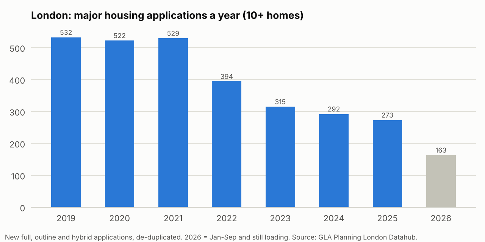
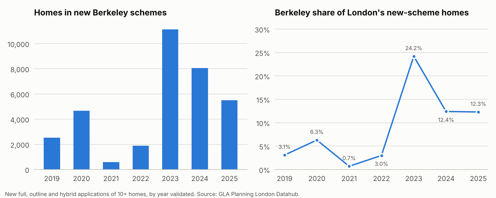
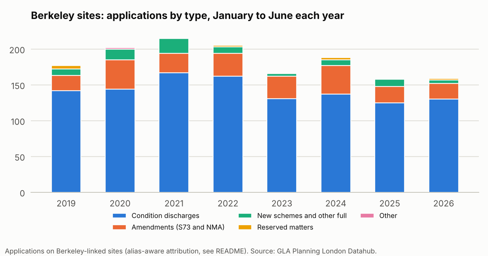
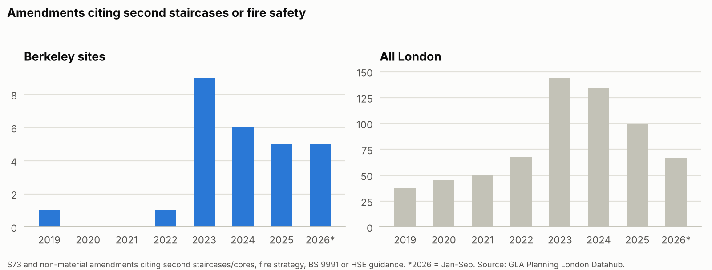

# London Planning Datahub: what it says about Berkeley Group

A Python pipeline that pulls every planning application from the GLA's **Planning London Datahub** (1.29 million records across 36 London planning authorities), cleans and classifies them, and asks two questions a sell-side analyst covering the UK housebuilders would ask:

1. What does London's planning pipeline look like, and how reliable is this data?
2. What does it say about **Berkeley Group** (LSE: BKG), the most London-exposed listed builder?

Data extracted 9 October 2026. Figures below are produced by the code in `src/`; nothing is typed in by hand.

## Key findings

**London's pipeline has roughly halved.** There were 273 major housing applications (10+ homes) in 2025, against an average of 528 a year in 2019–21 (−48%). The homes in them fell from about 79,000 to 45,000. The median time to decide a major housing application rose from 200 days in 2019 to 412 in 2025. Build-to-rent went from 2.4% to 39.8% of homes where tenure is recorded, while market sale fell from 58.7% to 27.8%.



**Berkeley took a much bigger slice of a smaller pipeline.** Homes in new Berkeley schemes applied for rose from 9,671 in 2019–22 to 24,704 in 2023–25, lifting its share of London's new major-scheme homes from 3.2% to 15.9%. Most of that is re-planning land it already holds rather than new land:

- a new 5,566-home outline at The Green Quarter (Southall);
- a 3,083-home outline for Woodberry Down phases 5–8;
- former gasworks under St William: Bromley-by-Bow (2,200), Beckton (5,776), Kensal and Motspur Park.

That matches Berkeley's own strategy statements: no new land except through joint ventures, and adding value to existing holdings through planning.



**Construction-linked filings have stepped down.** January to June is the latest window not distorted by reporting lags. In that window, applications on Berkeley sites were 160 in both 2025 and 2026, 26% below the 2021 peak of 217. Condition discharges are the best proxy for sites moving into construction; they were 130 in 2026 and 125 in 2025, against 167 in 2021. That is consistent with Berkeley's September 2026 statement that it is cutting production by around 25% over four years. Amendments held up, in line with Berkeley's "more than 40 planning amendments… for additional homes" in FY26.



**Building safety shows up in the text.** Amendments on Berkeley sites citing second staircases or fire safety went from 2 in 2019–22 to 25 since 2023, across 11 schemes. Several add homes at the same time, for example two extra storeys at Silkstream. Berkeley files 5.6% of London's fire-safety redesigns but only 1.3% of all London amendments, consistent with a tall pipeline: 91% of its 100+ home applications include a building of seven or more storeys, against 82% for London.



**Planning risk is rising.** Eight large Berkeley applications covering about 12,500 homes await a decision in the data. They include Beckton (5,776 homes, outstanding for over 700 days; Berkeley says the GLA called it in), Bermondsey Place, Kensal and a masterplan-wide amendment at Kidbrooke Village. The Aylesham Centre in Peckham (about 870 homes) was not approved and the appeal was dismissed in May 2026. Motspur Park was refused locally and called in.

**Peers.** On applications that name the developer, Berkeley accounts for 78% of 2023–25 homes among the listed builders. The volume builders have largely stopped originating London schemes; Vistry's partnership model is the exception.

## What I think of the data

It is good for direction and for tracking individual schemes almost in real time. It is not usable for totals without heavy cleaning, and it cannot tell you who the applicant is.

| Strengths | Problems |
|---|---|
| Free, keyless Elasticsearch API; the whole index downloads in about 10 minutes | No applicant or agent field; the developer is named on only 33% of 2025 major applications (12% in 2019) |
| Complete from 2019 for all 36 authorities, synced daily | The homes field is blank on 44% of 2019 major applications (15% in 2025) |
| Structured homes by tenure, building heights, phasing, conditions, appeals, commencement | 114,330 records (8.9%) geocoded outside London, mostly the British National Grid origin |
| Reference numbers in descriptions let you rebuild a scheme's history (191,216 links) | 116 decision values and 157 spellings of borough names |
| | Non-applications mixed in: 61,512 neighbouring-borough consultations, EIA scoping requests and pre-application cases |
| | Stale feeds (Bromley since July 2025, Brent since May 2026, Kensington & Chelsea since June 2026), the latest two months still loading, and some schemes missing |

## Finding Berkeley's applications (the alias problem)

Berkeley applies through divisions, site companies and joint ventures: Berkeley Homes (Capital) plc, Berkeley Homes (East Thames) Ltd, St George, St James, St Edward (JV with M&G), St William (JV with National Grid until 2022), St Joseph and numbered site companies. The pipeline handles this in layers.

1. **Brand and division rules** on the developer field, with exclusions for look-alikes (Berkeley Square Holdings, the Berkeley Hotel, St James' Court, St George's Hospital and so on).
2. **The full company list.** 503 Berkeley Group companies and 273 former names, taken from the 2026 annual report and Companies House (`config/berkeley_entities.csv`), plus **company registration numbers**. One Islington application lists a councillor as developer but carries Berkeley Homes (North East London)'s company number.
3. **Curated head permissions** for schemes on Berkeley's own development list whose records name no developer (`config/berkeley_curated_heads.csv`, each with a confidence level).
4. **Reference-number linking.** Every S73, non-material amendment, reserved matters and condition discharge that cites a Berkeley permission is pulled in. The walk goes up to six steps, stays within 2 km, and stops at records that name another developer.

That gives 3,052 applications since 2019 across 46 schemes. Only 104 of them name a Berkeley company. In this data the alias problem is mostly blank developer fields rather than unfamiliar company names: the full company list found nothing the brand rules and registration numbers had missed. Site-based linking does most of the work.

## Caveats

- Schemes that finished before 2019 are under-represented; read trends from 2019.
- Datahub status lags events (Beckton still shows as awaiting a decision after its GLA call-in), and "lapsed" flags may only mean a start was never recorded.
- Homes are what applications propose; re-plans re-count homes on sites that already had permission.
- Some Berkeley schemes are missing from the Datahub, such as the 2025–26 Lea Bridge gasworks re-plan.

## Running it

```bash
pip install -r requirements.txt
python src/fetch_all.py           # download every record (about 10 minutes, ~185 MB parquet)
python src/clean.py               # classify, de-duplicate, estimate homes
python src/berkeley_universe.py   # build the Berkeley application set
python src/london_overview.py     # London-wide metrics
python src/berkeley_analysis.py   # Berkeley metrics and peers
python src/data_quality.py        # data-quality profile
python src/export_dashboard.py    # datasets behind the dashboard
python src/make_charts.py         # charts in images/
```

| Path | What it is |
|---|---|
| `src/pld_client.py` | Minimal client for the Datahub's public Elasticsearch endpoint |
| `src/clean.py` | Date parsing, decision normalisation, application-type classifier, duplicate and consultation flags, homes estimate |
| `src/refgraph.py` | Links applications to the permissions they cite |
| `src/developers.py` | Brand and listed-peer matching rules |
| `config/` | Curated Berkeley head permissions and the Berkeley company list |
| `output/` | Metrics as JSON/CSV, including `output/dashboard/` (the datasets behind the interactive dashboard) |
| `images/` | Charts used above |

Source: GLA Planning London Datahub (planningdata.london.gov.uk). Company statements are from Berkeley's April 2026 strategy update, June 2026 full-year results and September 2026 trading update.
